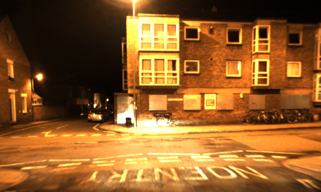
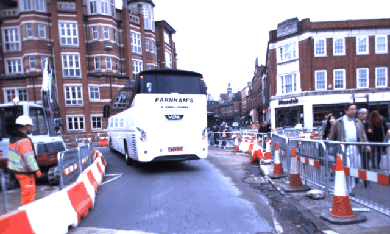
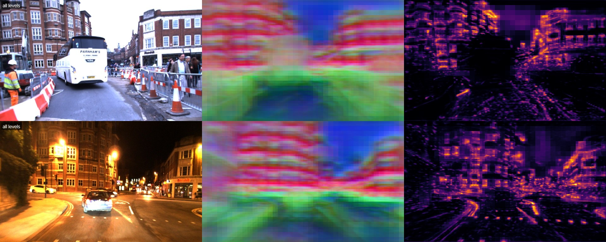
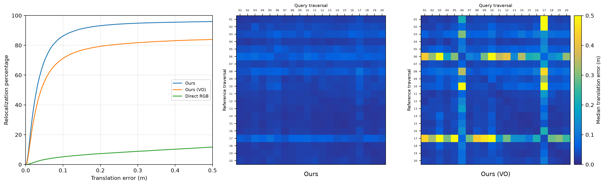

<h1 align="center">Unsupervised Metric Relocalization Using Transform Consistency Loss</h1>

<p align="center">
  Mike Kasper, Fernando Nobre, Christoffer Heckman, Nima Keivan<br/>
  <b>Conference on Robot Learning (CoRL) 2020</b>
</p>

<p align="center">
  <a href="https://proceedings.mlr.press/v155/kasper21a/kasper21a.pdf"></a> &nbsp;
  <a href="https://huggingface.co/mkaspr/tcloc-full-oxford-robotcar"></a> &nbsp;
  <a href="https://huggingface.co/datasets/mkaspr/tcloc-oxford-robotcar"></a>
</p>

<p align="center">
  
  
  <em>Metric relocalization on the Oxford RobotCar Dataset. Each animation flips
  between a reference image<br/>
  and the same view with a query image warped into it using the pose estimated
  by <b>TCLoc</b>.</em>
</p>

## Introduction

**TCLoc** is a modern PyTorch implementation of the original paper. It is
capable of centimeter-accurate camera relocalization across day, night, snow and
sun, learned without ground-truth poses. **TCLoc** learns dense features and
saliency maps that make direct image alignment work across lighting, weather and
seasons without the need for ground-truth relative poses between reference and
query images. Instead, *transform consistency* (the agreement between
independent relocalization solutions) serves as a self-supervised loss. To train
a **TCLoc** model, we only require the following:

1. Dense depth maps for each reference image
2. Accurate relative poses between reference images
3. Query images with sufficient overlap with reference images


Given these minimal requirements, we easily curate large training datasets. For
example, we extracted over 2.4M training examples from just 20 traversals of the
[Oxford RobotCar Dataset](https://robotcar-dataset.robots.ox.ac.uk/). On 40,000
test registrations across 20 unseen traversals, 94.2% are self-consistent to
within 25 cm (median 2.9 cm). Against RobotCar's RTK ground-truth, the same
model's median absolute error is 45 cm, from a median starting offset of 3.1 m.

## Try it yourself

The follow commands downloads the model and a small dataset (600 m of four
Oxford RobotCar Dataset traversals, ~240MB), performs a handful of
reference-query registrations, then writes metrics and visualisations to
`outputs/demo/`.

You need [uv](https://docs.astral.sh/uv/). A GPU helps (NVIDIA or Apple silicon)
but is not required.

```bash
git clone https://github.com/mkaspr/tcloc && cd tcloc
uv run tcloc demo
```

Once the model and dataset have been downloaded, you can manually perform
registration and generate metrics and other visuals with the following commands:

```bash
REFERENCE="2014-11-28-12-07-13/1417178545026839"
QUERY="2015-09-01-21-44-08/1441141568662091"

# Perform registration with the specified reference and query frames.
uv run tcloc track --ref $REFERENCE --query $QUERY

# Generate reprojection images of the resulting registration.
uv run tcloc reproject --ref $REFERENCE --query $QUERY --gif

# Visualize the feature and saliency maps for the reference and query frames.
uv run tcloc features --frames $REFERENCE $QUERY --combined

# Evaluate the model on the 200 examples from dataset.
uv run tcloc evaluate

# Fine-tune the downloaded model on the traversals in a dataset.
uv run tcloc train --out runs/finetune --updates 500
```

Frames are referenced `TRAVERSAL/TIMESTAMP`. As a shortcut, a query given as
`TRAVERSAL` alone is that traversal's keyframe nearest the reference by GPS
position. Every command has `--help`. An example of the feature and saliency
maps produced by the `tcloc features` command is shown below.

<p align="center">
  
  <em>A visualization of the feature and saliency maps generated for the same
  location, captured on different dates. Note the similarity between features
  despite the differneces in the input images and how the saliency maps ignores
  unreliable regions of the images like vehicles, people, and roadwork.
  </em>
</p>

## How it works

1. **Network** ([model.py](tcloc/model.py)): a U-Net with a frozen ImageNet
VGG-16 encoder.  At five resolutions it predicts a 16-channel feature map and a
saliency map.
2. **Tracker** ([tracker.py](tcloc/tracker.py)): inverse-compositional
Gauss-Newton aligns the query's features with the reference's, coarse to fine,
weighting each pixel by both saliency maps. Every step is differentiable.
3. **Losses** ([losses.py](tcloc/losses.py)): a training sample is a
*triplet*, two reference frames from one drive and a query from another. The
query is registered to both references; carried through the known
reference-to-reference motion (visual odometry), the two answers must agree
(**consistency**). The two references are also registered to each other and
compared with the odometry (**accuracy**), which fixes the metric scale. No
query ground truth is used.

## Results

The test dataset is curated from 20 traversals never used for training or model
selection. For each of the 400 reference-query traversal pairs, we randomly
sample 100 triplets. We evaluate the translation consistency on these 40K
triplets and compare it with the same architecture trained solely with the
accuracy loss, "Ours (VO)", and direct registration using the input RGB images.
Results from this evaluation are shown below.

| model | median | < 5 cm | < 10 cm | < 25 cm | < 50 cm |
|---|---|---|---|---|---|
| **Ours**: consistency + accuracy loss | **2.9 cm** | **69.4 %** | **86.3 %** | **94.2 %** | **95.9 %** |
| Ours (VO): only accuracy loss | 4.1 cm | 55.6 % | 71.2 % | 80.7 % | 83.9 % |
| Direct RGB | 3.38 m | 3.3 % | 5.2 % | 8.1 % | 11.7 % |

**Direct RGB** runs the same tracker on the image pyramid itself instead of
learned features, with each colour channel normalised per image (zero mean, unit
variance) and every pixel weighted equally.

<p align="center">
  
  <em>Left: percentage of registrations below the specified error threshold.
  Middle and right: median error for each pair of reference (rows) and query
  (columns) traversal for both the full and VO-only models. Consistency loss
  matters most for night traversals (rows and columns 06 and 17).</em>
</p>


More notes on model's evaluation:

- **The error is the paper's Eq. 5.** The query is registered to both
references, and the reference-to-reference motion this implies is compared with
visual odometry. It needs no ground truth for the query, but errors shared by
both registrations cancel, so it measures consistency and is a lower bound on
absolute error.
- **Absolute error against RTK GPS** has a median of 0.45 m. RTK in RobotCar is
itself inconsistent between drives by decimeters (warping images with our poses
aligns them better than with RTK on 60 of 60 checked pairs), so treat 0.45 m as
an upper bound.
- **The reference images need depth**. References whose
stereo is poor, such as raindrops on the lens at night, halve the success rate;
two such rainy traversals are reported separately as failure modes.
- **The tracker converges for heading errors up to about 10-15 degrees.** Beyond
that it needs a better starting point, for example from place recognition.

The [dataset card](https://huggingface.co/datasets/mkaspr/tcloc-oxford-robotcar)
gives the triplet geometry, the splits and how the data was processed.

## Your own data

Write your traversals in the format described at the top of
[data.py](tcloc/data.py). Each frame requires an image, a depth map, a
visual odometry pose and an approximate global position. You may then evaluate
and fine-tune on it as follows:

```bash
# Evaluate the pretrained model on the new dataset.
uv run tcloc evaluate --data path/to/dataset --sample 500

# Fine-tune the pretrained model on the new dataset.
uv run tcloc train --data path/to/dataset --out runs/mine

# Evaluate the fine-tuned model on the new dataset.
uv run tcloc evaluate --data path/to/dataset --sample 500 --model runs/mine/model
```

### RobotCar

> [!WARNING]
> The Oxford RobotCar Dataset has been withdrawn by its authors until further
> notice, so its raw data cannot currently be downloaded. If you already have
> it, point `--raw` at it (one `<traversal>/stereo/{left,right}/` folder per
> traversal) and nothing is downloaded:
> `uv run tcloc prepare robotcar --raw path/to/robotcar`.

To rebuild the RobotCar dataset from the raw data (needs a free RobotCar
account), use the published metadata:

```bash
# Prepare the full RobotCar dataset.
uv run tcloc prepare robotcar

# Prepare a subset of traverses from the RobotCar dataset.
uv run tcloc prepare robotcar --traversals 2014-12-09-13-21-02 2015-02-03-19-43-11

# Evaluate the model using the RobotCar RTK ground-truth data.
uv run tcloc evaluate --data data/robotcar --sample 300 --absolute
```

### 4Seasons

Support for the
[4Seasons dataset](https://cvg.cit.tum.de/data/datasets/4seasons-dataset) as
been added to facilitate extensions of this work. You must first download and
unzip the recordings (undistorted stereo images and reference poses) and
`calibration.zip` into one folder. From there, you may work with the dataset
just like the Oxford RobotCar Dataset.

```bash
# Prepare the full 4Seaons dataset.
uv run tcloc prepare 4seasons --raw path/to/4seasons

# Prepare a subset of traverses from the RobotCar dataset.
uv run tcloc prepare 4seasons --raw path/to/4seasons \
  --traversals 2020-03-24_17-36-22 2020-06-12_10-10-57

# Evaluate the model using the 4Seasons RTK ground-truth data.
uv run tcloc evaluate --data data/4seasons --sample 300 --absolute
```


## Models and data

| | |
|---|---|
| [mkaspr/tcloc-full-oxford-robotcar](https://huggingface.co/mkaspr/tcloc-full-oxford-robotcar) | the model (`--model full`, the default) |
| [mkaspr/tcloc-vo-only-oxford-robotcar](https://huggingface.co/mkaspr/tcloc-vo-only-oxford-robotcar) | trained with the accuracy loss only (`--model vo-only`) |
| [mkaspr/tcloc-oxford-robotcar](https://huggingface.co/datasets/mkaspr/tcloc-oxford-robotcar) | the mini dataset and the metadata of the full one |

## Differences from the paper

While migrating the original 2020 implementation from TensorFlow to modern
PyTorch and retraining the model from scratch, the following changes were
introduced:

- **Pyramid levels** a fifth pyramid level was introduced which widens the
convergence basin.
- **Training perturbations:** the starting pose is perturbed by up to ±6° of
heading. Consistency targets come from unperturbed registrations, however, so
one perturbed registration cannot corrupt the other's target.
- **Data:** a new split of RobotCar (20 training, 7 validation and 20 test
  traversals) with over 10x the number of triplets.

## License and citation

The code is MIT licensed. The released models and data are derived from the
Oxford RobotCar Dataset and are licensed [CC BY-NC-SA
4.0](https://creativecommons.org/licenses/by-nc-sa/4.0/). Please cite the paper
and the dataset:

```bibtex
@inproceedings{kasper2020unsupervised,
  title     = {Unsupervised Metric Relocalization Using Transform Consistency Loss},
  author    = {Kasper, Mike and Nobre, Fernando and Heckman, Christoffer and Keivan, Nima},
  booktitle = {Conference on Robot Learning (CoRL)},
  year      = {2020}
}

@article{maddern2017robotcar,
  title   = {1 Year, 1000km: The Oxford RobotCar Dataset},
  author  = {Maddern, Will and Pascoe, Geoffrey and Linegar, Chris and Newman, Paul},
  journal = {The International Journal of Robotics Research},
  volume  = {36},
  number  = {1},
  pages   = {3--15},
  year    = {2017}
}
```
